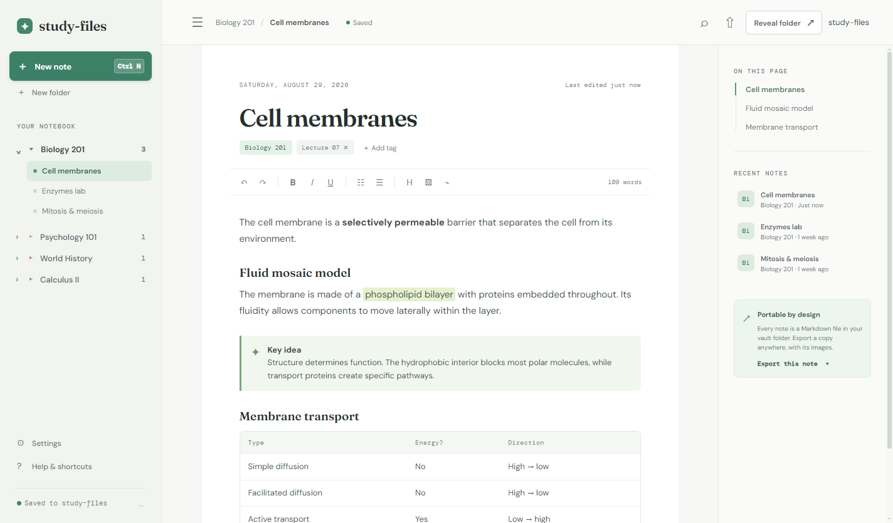
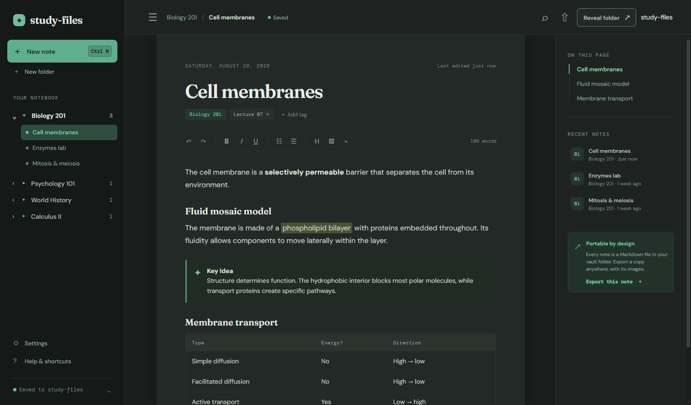
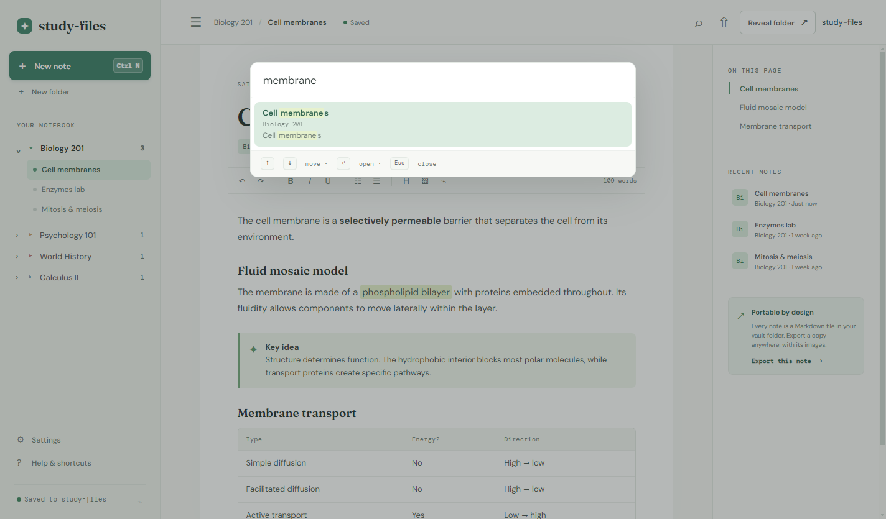

<div align="center">


# study-files

**A filesystem-first notes app for classwork.**

Your notes are ordinary Markdown files in ordinary folders. No database, no account,
no sync service, no subscription — open your notes in any editor, on any machine,
and everything is exactly where you left it.

### [⬇ Download the latest release](../../releases/latest)




</div>

---

## Download

| Platform | File | Notes |
| --- | --- | --- |
| **Windows** | `study-files-Setup-<version>.exe` | Installer. Installs for your user only — no administrator prompt |
| **Windows** | `study-files-<version>-portable.exe` | Single file. Run it from anywhere, including a USB stick |
| **Linux** | `study-files-<version>.AppImage` | `chmod +x` it and run. Works on most distributions |
| **Linux** | `study-files_<version>_amd64.deb` | Debian, Ubuntu, Mint |
| **Linux** | `study-files-<version>.x86_64.rpm` | Fedora, RHEL, openSUSE |

All builds are 64-bit. Get them from the [releases page](../../releases/latest).

> **Windows SmartScreen** may warn you the first time, because these builds are not
> code-signed — a certificate costs several hundred dollars a year. Click **More info** →
> **Run anyway** if you trust the source.

## Light and dark

Follows your desktop theme by default, or pin it to one.

<table>
<tr>
<td width="50%"></td>
<td width="50%"></td>
</tr>
<tr>
<td align="center"><sub><b>Light</b></sub></td>
<td align="center"><sub><b>Dark</b></sub></td>
</tr>
</table>

## Search everything

<kbd>Ctrl</kbd> <kbd>K</kbd> searches titles and note bodies, with the match highlighted in
context.



## Your notes are just files

```
Documents/study-files/
  Biology 201/
    cell-membranes.md
    cell-membranes-assets/diagram-1.png
```

Every note is a Markdown file with a small YAML header. Nothing is locked in a proprietary
format, nothing lives in a cloud you don't control, and if you stop using this app your
notes are still perfectly readable.

Writes are **atomic**, so a crash mid-save cannot corrupt a note. Deletes go to your
**system trash**, not straight to oblivion. Edit a note in another app and study-files picks
up the change automatically.

## Features

- **Rich editing** — headings, bold, italics, underline, highlight, lists, callouts,
  tables, and inline images
- **Sketchpad** — draw with a mouse, trackpad, or pen and drop it into the note
- **Outline** — generated from your headings, with scroll tracking
- **Folders and tags** — organise by class, find things fast
- **Export** — hand a note to someone else as Markdown with its images
- **Completely offline** — no telemetry, no accounts, no network requests of any kind
- **Accessible** — full keyboard navigation and screen-reader labels

## Keyboard shortcuts

| Shortcut | Action |
| --- | --- |
| <kbd>Ctrl</kbd> <kbd>N</kbd> | New note |
| <kbd>Ctrl</kbd> <kbd>⇧</kbd> <kbd>N</kbd> | New folder |
| <kbd>Ctrl</kbd> <kbd>S</kbd> | Save now |
| <kbd>Ctrl</kbd> <kbd>E</kbd> | Export as Markdown |
| <kbd>Ctrl</kbd> <kbd>K</kbd> | Search all notes |
| <kbd>Ctrl</kbd> <kbd>,</kbd> | Settings |
| <kbd>Ctrl</kbd> <kbd>/</kbd> | Shortcuts |
| <kbd>Ctrl</kbd> <kbd>⇧</kbd> <kbd>D</kbd> | Toggle dark mode |
| <kbd>Ctrl</kbd> <kbd>\</kbd> | Toggle sidebar |
| <kbd>F2</kbd> | Rename note |
| <kbd>Esc</kbd> | Close dialog |

## Privacy

study-files makes **no network requests**. Fonts are bundled with the app, its Content
Security Policy forbids outbound connections entirely, and there is no analytics,
telemetry, crash reporting, or update check. Your notes never leave your disk.

## License

Free to use. Not free to sell, modify, or redistribute — see [LICENSE](LICENSE).

This repository distributes the application only; the source is not public.

The bundled DM Sans, DM Mono and Fraunces typefaces are separately licensed under the SIL
Open Font License 1.1, and Electron and its dependencies under their own terms. Their
license texts ship inside the application.

---

<div align="center">
<sub>Questions or a problem with a build? <a href="../../issues">Open an issue</a>.</sub>
</div>
